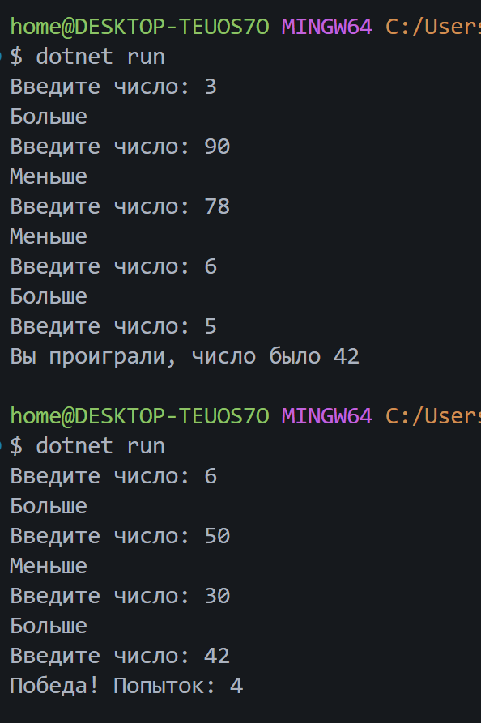
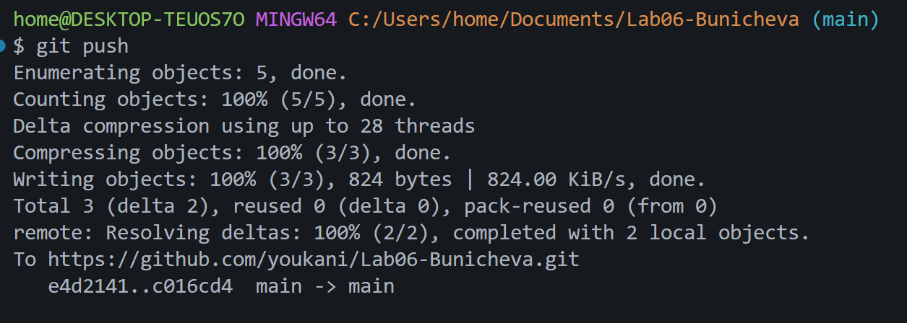

# Практическая работа №6
**ФИО:** буничева Алёна Алексеевна
**Группа:** ИСП-242
**Дата:** 11.10.2026
## Что изучено
- **Разница между while и do while:** Цикл `while` проверяет условие до начала работы и может не выполниться ни разу, а в `do while` условие проверяется после тела, поэтому тело выполнится минимум один раз.
- **break и continue:** `continue` позволяет пропустить оставшуюся часть кода в текущем шаге и перейти к следующему, а `break` полностью останавливает и завершает работу цикла.
- **Цикл for:** Цикл `for` нужен для задач с известным количеством повторений.

